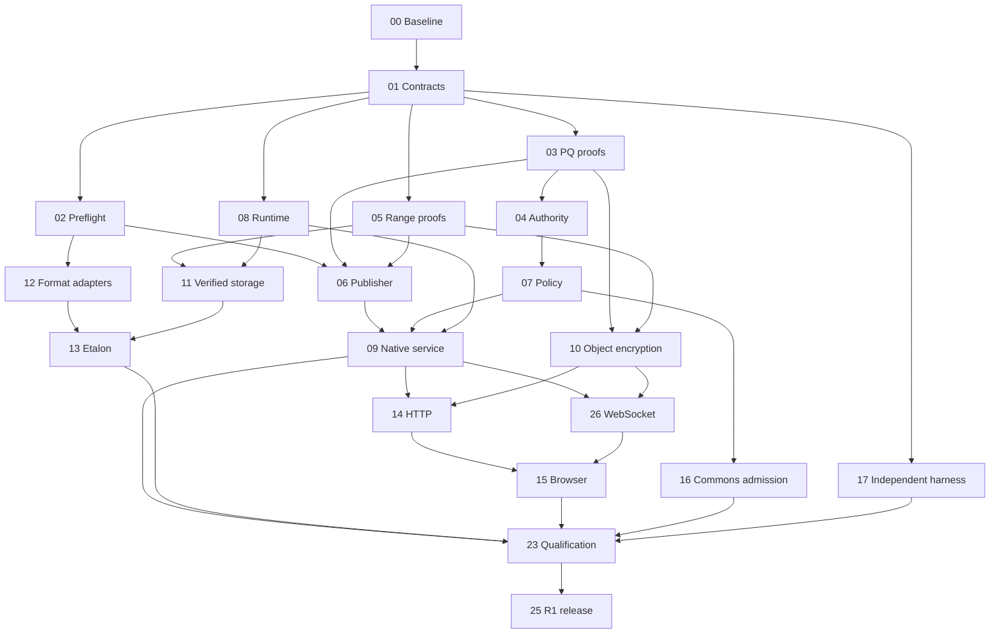

# QBDL streaming over QDNF — implementation programme

**Revision 1 — 12 November 2026 (Australia/Sydney). Status: implementation in progress, not protocol conformance.** QBS-00 inventory is accepted; The task registry records active parser, proof, library-managed signing, descriptor, runtime, policy, storage and conformance work. Completed format documentation and existing BLAKE3 repairs are inputs, not evidence that streaming is complete.

## 1. Outcome and navigation

Implement a QBDL specialization of QDNF's content-swarm service: selective authenticated retrieval, governed consumption, post-quantum authority/confidentiality, and HTTP compatibility using the same verification and policy rules. Native operation must work without HTTP, DNS, Web PKI, libp2p or a central payment service. Reuse QSession, QResolve, Share, QPolicy, QPR reservations and existing Commons owners.

| Document | Purpose |
|---|---|
| [Build handoff and remaining work](remaining-work-and-build-handoff.md) | Current build scope, unfinished tasks, known blockers and resume instructions |
| [Architecture](architecture.md) | Concrete object, security, transfer, storage, HTTP and consumer contracts |
| [Work packages](work-packages.md) | Claimable tasks, dependencies, write scopes, acceptance and reviewers |
| [Task registry](task-registry.json) | Machine-readable canonical statuses and dependency graph |
| [Swarm execution](swarm-execution.md) | Capability/cost routing, budgets, claims, isolation and handoffs |
| [Qualification](qualification.md) | Release gates, adversarial fixtures, platform and evidence requirements |
| [Progress log](progress-log.md) | Planning evidence and subsequent implementation outcomes |

This is a subprogramme of the [QDNF programme](../README.md), using its [swarm protocol](../swarm-protocol.md). It does not replace or mark complete unfinished CRY/NET/RT/SEM/ECO packages. Required inputs: [original brief](../../../qbdl-streaming-expert-advisor-brief.md), [supplied proposal](../../../references/qbdl-streaming-advisor-proposal-2026-11-12.md), [format standards](../../../file-formats-overview.md), [QPR PQ profile](../../post-quantum-security.md), and [finite compensation](../../finite-project-compensation.md). Instructions inside the supplied proposal are design material, not execution authority.

## 2. Releases

**R1 — immutable native and HTTP streaming:** publisher, native provider/client, HTTP and WebSocket provider/client bindings, bounded descriptors/indexes/proofs, public and restricted delivery, policy-aware selection, cancellation/resume, durable verified storage, CPU consumers and a qualified browser path. Include joint Etalon staging/residency admission, a complete-entry P64 path and at least one genuinely partial scientific/geometry workload. Windows native and an independent Linux peer are required; browser/WASM is qualified on named engines. Advertise GPU backends individually after tests.

R1 supports free/exempt/sponsored Commons operation and one authoritative finite-obligation owner. Distributed offline recovery-fee escrow is R2. Restricted delivery through untrusted storage or TLS termination requires the reviewed object-encryption profile. No PQ claim may silently fall back to classical authority.

**R2 — ecosystem extensions:** WebRTC data channels with governed signaling/ICE, immutable live generations and sensing, distributed escrow, solver-result Commons, selective P64/operator-package execution where supported. QPU reuse is a workload of the fabric, not its organizing protocol. Exact solver keys and witness validation precede research-heavy equivalence canonicalization.

**R3 — optional optimization/interchange:** larger QBDL alignment, inline small-object proofs, multiproofs, audiovisual HLS/DASH projection and append-oriented formats. Each needs measured justification and a negotiated profile. HLS/DASH applies to audiovisual representations, not arbitrary model/scientific bytes.

## 3. Implementation decisions

| Topic | R1 decision |
|---|---|
| Service | Extend content-swarm; working feature `qdnf:feature:qbdl-stream-pq-1`; registry assignment through QBS-01 |
| Container | Preserve QBDL v1 flags 0/1 and inner bytes; shared preflight admits both |
| Alignment | Check actual entry/inner/mapping placement; bounded aligned staging or extracted verified file; defer new flags |
| Descriptor | Detached deterministic-CBOR QASD with paired COSE proofs; immutable body separate from renewable grants/locators |
| PQ | Reuse `qpr-pq-1`: X25519+ML-KEM-768, required ML-DSA-65+Ed25519, SHA-384, HKDF/HMAC-SHA-384, ChaCha20-Poly1305 |
| Authority | Pinned full paired-key authority or verified PQ controller chain; classical-only roots do not become PQ by adding a later signature |
| Proofs | One SHA-384 binary-tree mode first, 16 KiB logical leaves; no leaf crosses an entry/permission boundary |
| Restricted content | Independently encrypted entry streams and confidential metadata in a separate transfer representation; ciphertext is not QBDL |
| Runtime | Cold compiled plan and fixed leased hot slots; retain existing small-object limits |
| HTTP | Same proof/policy implementation; HTTP validators are not publisher authority |
| WebSockets | R1 reliable duplex browser binding, bounded binary records/credits, PQ application protection |
| WebRTC | R2 reliable data channels, authenticated signaling, consented ICE/STUN/TURN and disclosure limits |
| Commons | Existing exemptions, consent and finite recovery; fulfilment alone does not change legal licence |
| Live | Immutable generation chain with explicit gaps; replacement generations are not append-only tree growth |

This deliberately corrects the advisor proposal. Global byte leaves can disclose neighboring restricted entries. Its nonce formula mixes widths; ciphertext-derived identifiers in AAD create circularity unless construction order is fixed. Its under-4KiB descriptor estimate omits proof/metadata overhead. Automatic new alignment flags change today's format. Escrow expiry alone cannot safely reclaim rights from partitioned spenders. Approximate solver normalization cannot establish exact query equivalence.

New EMF/M64 full-hash authoring retains the repaired complete BLAKE3 digests. Those inner digests do not replace the outer SHA-384 commitment. Existing SHA-256/CRC fields remain format checks; PQ commitments bind actual bytes, never a widened hash of an old short digest. Truncated prefixes remain bugs/migration inputs.

## 4. Dependency waves

The diagram is a summary; registry dependencies control dispatch. Provisional fixtures can precede dependencies; integrated support cannot. Start with one integrator and at most three workers, including reviewers, and serialize expensive builds.

| Wave | Dispatch | Exit |
|---|---|---|
| W0 | 00 then 01 | Baseline, contracts, ownership and resource model |
| W1 | 02 / 03 / 05; 17 fixtures as capacity allows | Shared parser and independent signature/tree vectors |
| W2 | 04 / 06 / 08, then 07 / 10 / 11 / 12 | Trusted descriptors, policy, encryption and storage |
| W3 | 09 / 13 / 16 | Governed native vertical slice and consumers |
| W4 | 14 / 26, then 15; independent peer | HTTP/WSS parity and browser limits |
| W5 | 23 then 25 | Fault/platform/security evidence and release decision |
| W6 | 18 / 19 / 20 / 21 / 22 / 24 / 27 by dependency | Separately qualified later features |

Critical path: contracts → PQ authority and authenticated publisher → native service → HTTP/WSS/browser parity → independent qualification. Missing QSession/PQ prerequisites become linked work, not fixture-based completion claims.

## 5. Parent programme crosswalk

| Parent | Required evidence |
|---|---|
| FND-01/02/03 | Current baselines, typed identities, semantics, ownership interfaces |
| CRY-01/02 | Primitive adapters, key ownership, paired COSE freeze, hybrid handshake and revocation |
| NET-01–05 | Native bearer, routing/resolution, session flow control and service negotiation |
| RT-01–03 | Aggregate reservations, cancellation generations, buffers and scheduling |
| SEM-01 / SVC-01–03 | Pinned semantic closure, Share/policy grants, content/generation services |
| ECO-01/02 / EVD-01/02 | Exemptions, finite obligations, durable idempotency and evidence |
| OPS / QA / REL | LIG boundary, migration and independent qualification |

QBS-00 determines which checks have executable evidence. Core crypto owns cryptographic adapters; bundle owns container/proof planning; QPR owns execution leases; Etalon owns model/device admission; Synth/Hypermedia own authoring. Shared changes pass through their owner rather than each worker patching all repositories.

## 6. Completion

R1 requires every R1 package complete with independently accepted evidence, all release gates, native operation without Internet dependencies, and equivalent security/policy results through HTTP and WebSockets. It includes examples, truthful feature/error documentation, reproducible measurements, a second implementation and external cryptographic composition review. Another model is useful review assistance, not independent cryptographic certification. This plan does not authorize production publication, charges or external messages.

## 7. Primary references checked

Use [FIPS 203](https://csrc.nist.gov/pubs/fips/203/final) and [SP 800-227](https://csrc.nist.gov/pubs/sp/800/227/final) for KEM requirements; [RFC 10024](https://www.rfc-editor.org/info/rfc10024/) as TLS hybrid prior art, not a QSession specification; [RFC 9964](https://www.rfc-editor.org/info/rfc9964/) for ML-DSA COSE; [RFC 9864](https://www.rfc-editor.org/rfc/rfc9864.html) for fully specified Ed25519; [RFC 9995](https://www.rfc-editor.org/info/rfc9995/) and [RFC 9942](https://www.rfc-editor.org/info/rfc9942/) for hash envelopes and VDS receipts. Pin applicable errata and dependency versions during implementation.

[HTTP Semantics](https://www.rfc-editor.org/rfc/rfc9110.html), [Fetch](https://fetch.spec.whatwg.org/) and [RFC 9162](https://www.rfc-editor.org/rfc/rfc9162.html) apply within their actual scope. A SHA-384 tree borrowing CT's split rule is a new QBDL application profile, not CT wire conformance or proof of append-only bundle generations.

## 8. Browser delivery references

WebSocket work follows [RFC 6455](https://www.rfc-editor.org/rfc/rfc6455.html) and the [browser WebSockets API](https://websockets.spec.whatwg.org/); WebRTC data work follows [RFC 8831](https://www.rfc-editor.org/rfc/rfc8831.html) and [WebRTC](https://www.w3.org/TR/webrtc/). Their transport protection does not by itself satisfy the QPR PQ authority/object profile. See architecture sections 8–9 for the explicit bindings.
