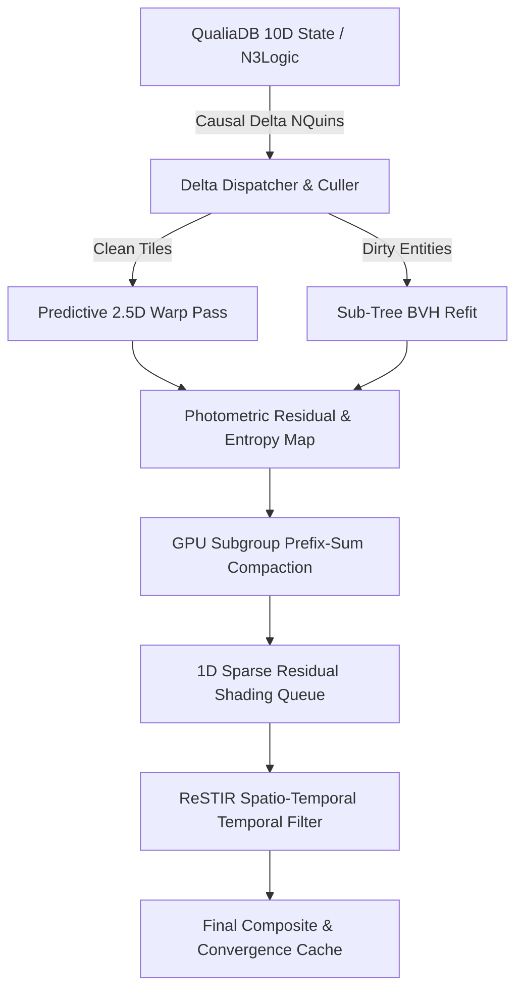

# Differential 3D Video Codec Rendering: Theoretical Foundation & QualiaDB Architecture Plan

_Status: Draft & Architectural Review | Target: QualiaDB 10D Holo-Engine & Webizen Render | Date: 2026-10-19_

---

## 1. Executive Summary: The Differential Paradigm Shift

Traditional real-time 3D renderers (rasterizers and path tracers alike) are fundamentally **stateless brute-force loops**. At 60 Hz or 120 Hz, the rendering engine clears the frame buffers, traverses the entire scene graph, refits or rebuilds acceleration structures (BVHs), submits thousands of draw calls, and calculates surface radiance from scratch. In typical virtual worlds, games, and CAD environments, **over 85% to 95% of the scene is spatially static or kinematically predictable**, and camera movement between adjacent frames is continuous and small. Expending billions of GPU floating-point operations recalculating identical geometric and photometric truths is an enormous waste of thermal and battery budget.

This document formalizes **Differential 3D Video Codec Rendering**—a ground-up architecture that treats the 3D+ spatio-temporal scene not as a sequence of independent images, but as an **inter-frame compressed state stream**. By adapting the foundational mechanics of modern video compression codecs (MPEG-4 AVC/H.264, HEVC/H.265, AV1, and VVC):

1. **I-Frames (Intra / Keyframes):** Anchor state snapshots ($S_0$) containing complete spatial acceleration structures, dense G-Buffers, and calibrated radiance caches.
2. **P-Frames (Predicted Frames):** Delta states ($\Delta S_t$) that reproject invariant surface radiance along 3D scene-flow vectors, refit only dirty BVH sub-trees, and evaluate radiance *only* on disoccluded or high-entropy surfaces.
3. **B-Frames (Bi-directional Frames):** Continuous spacetime warping ($S_{t \pm \delta}$) that synthesizes ultra-high framerate intermediate frames (e.g., 120 Hz render ticks between 20 Hz simulation logic ticks) via 6-DoF analytical extrapolation and spherical harmonic interpolation.
4. **Residual Error ($R_t$):** The photometric discrepancy between predicted shading and ground-truth physics, used to dynamically steer 100% of the GPU's ray-tracing ALU budget strictly to areas where $\|R_t\| > \epsilon$.

### Why QualiaDB Inverts the Differential Challenge

In conventional engines (Unreal Engine 5, Unity, Bevy), the renderer is **ontologically blind**. It receives raw vertex buffers and bounding boxes without understanding the semantic relationships between objects. As a consequence, it must infer motion, disocclusions, and lighting changes *a posteriori* through expensive GPU screen-space heuristics (motion vectors, depth reprojection, variance-guided filtering).

**QualiaDB fundamentally inverts this paradigm into an *a priori* causal pipeline:**
- **N3Logic & SLG Arena:** Deterministic semantic rules provide symbolic causal invalidation (e.g., an opaque door closing guarantees zero light leakage from an adjacent room, locking it into a 0-compute cached state).
- **10D Manifold Coordinates:** Phase space coordinates ($D_1..D_{10}$) encode parametric kinematic trajectories ($D_4..D_6$) and scale/LOD ($D_7$), predicting disocclusion events *before* the frame begins.
- **48-Byte Super-Quins:** Fixed-stride, SIMD-aligned `NQuin` records map directly to WebGPU/DirectX 12 `StorageBuffer`s without serialization overhead, enabling branchless GPU delta-culling and zero-heap execution.

---

## 2. Theoretical Mapping: Video Codec Primitives in 10D Space

```
┌────────────────────────────────────────────────────────────────────────────────────────┐
│                        SPATIO-TEMPORAL VIDEO CODEC MAPPING                             │
├───────────────────────┬───────────────────────────────────┬────────────────────────────┤
│ Video Codec Concept   │ 3D+ / 10D Renderer Equivalent     │ QualiaDB Implementation    │
├───────────────────────┼───────────────────────────────────┼────────────────────────────┤
│ I-Frame (Intra-Frame) │ Epoch / Anchor State (S_0)        │ Full BVH build, 10D slice  │
│                       │ Complete Scene Evaluation         │ snapshot, dense radiance   │
├───────────────────────┼───────────────────────────────────┼────────────────────────────┤
│ P-Frame (Predicted)   │ Delta State (ΔS_t)                │ N3Logic dirty flags,       │
│                       │ Scene Flow + Sparse Shading       │ Sub-tree BVH refit,        │
│                       │                                   │ Prefix-sum sparse rays     │
├───────────────────────┼───────────────────────────────────┼────────────────────────────┤
│ B-Frame (Bi-dir Inter)│ Spacetime Hyperplane Slice        │ Parametric 10D trajectory  │
│                       │ 6-DoF Asynchronous Timewarp       │ eval, SH irradiance warp   │
├───────────────────────┼───────────────────────────────────┼────────────────────────────┤
│ Macroblock / Block    │ Screen-Space Tile / World Surfel  │ 16x16 compute tile,        │
│                       │ SGGX Microflake Cluster           │ 48-byte NQuin patch        │
├───────────────────────┼───────────────────────────────────┼────────────────────────────┤
│ Motion Vector (MV)    │ 3D Scene Flow + 10D Velocity      │ D_4..D_6 kinematic vector  │
├───────────────────────┼───────────────────────────────────┼────────────────────────────┤
│ Quantization (QP)     │ Perceptual Salience Budget        │ D_9 affective/focal weight │
│                       │ Foveated / Importance Shading     │ ray allocation per tile    │
├───────────────────────┼───────────────────────────────────┼────────────────────────────┤
│ Long-Term Ref (LTR)   │ Baked Impostor / Frozen Octree    │ Dormant sub-graph baked    │
│                       │ Static Background Node            │ into light-field proxy     │
└───────────────────────┴───────────────────────────────────┴────────────────────────────┘
```

---

## 3. Four Core Pillars of the Architecture

### Pillar A: Screen-Space & World-Space Temporal Reprojection (2.5D P-Frame)
Instead of rasterizing geometry from scratch, frame $t$ begins by reprojecting the G-Buffer from frame $t-1$:
$$\mathbf{x}_{t-1} = \Pi_{t-1} \left( \mathbf{X}_t - \mathbf{v}(\mathbf{X}_t) \Delta t \right)$$
where $\Pi_{t-1}$ is the camera view-projection matrix at $t-1$, $\mathbf{X}_t$ is the world-space position, and $\mathbf{v}$ is the 3D scene flow.

- **Disocclusion Invalidation:** When depth inconsistency occurs ($|z_{\text{reprojected}} - z_{\text{history}}| > \tau_z$), the pixel is flagged as a *disocclusion hole* and scheduled for sparse shading.
- **View-Dependent Shading Split:** Diffuse albedo and ambient irradiance are strictly view-independent ($\Delta L_d = 0$ on camera-only translation). Specular highlights and Fresnel reflectance are isolated into a view-dependent residual layer:
$$L(\mathbf{x}, \omega_o) = L_{\text{diffuse}}(\mathbf{x}) + L_{\text{specular}}(\mathbf{x}, \omega_o)$$
Only $L_{\text{specular}}$ requires residual re-evaluation under pure camera rotation/translation.

### Pillar B: Spatio-Temporal Reservoir Resampling (ReSTIR P-Frames)
Light paths are treated as Markovian historical streams. Rather than evaluating $M$ light candidates per pixel each frame:
1. Each pixel or surfel maintains a compact reservoir $\mathcal{R} = \{y, w_{\text{sum}}, M, W\}$.
2. On frame $t$, the reservoir from frame $t-1$ is temporally reused by evaluating the target function $\hat{p}(y)$ under the new geometry/shadow state.
3. Spatial reuse merges reservoirs across adjacent pixels with compatible normals and depths.
4. Convergence scales linearly with static dwell time, providing photorealistic illumination at $\le 1$ primary ray per pixel.

### Pillar C: Explicit 4D Primitive Deformation ($\Delta G$)
In Gaussian Splatting and Surfel architectures (such as QualiaDB's 32-byte `SURF1` primitives):
$$G_t = G_0 + \sum_{k} \Delta G_k(t)$$
- Static background splats ($>80\%$ of typical scenes) have $\Delta G = 0$.
- Their view-space depth sorting and covariance projection matrices $\Sigma' = J W \Sigma W^T J^T$ are cached and incrementally updated via affine perturbation:
$$\Sigma'_t \approx \Sigma'_{t-1} + \nabla_{\mathbf{T}} \Sigma' \cdot \Delta \mathbf{T}$$
eliminating redundant radix sorting of millions of primitives.

### Pillar D: State-Graph Delta Propagation & Reactive BVHs
Rather than rebuilding linear BVHs from scratch:
1. State mutations in QualiaDB emit fine-grained delta quins (`TransformDelta`, `MaterialDelta`, `TopologyDelta`).
2. **Bottom-Up AABB Refitting:** Only leaf nodes referenced by mutated quins update their bounding boxes; AABB adjustments propagate upward toward the root.
3. **Asynchronous Deep Rebuild:** A full surface-area heuristic (SAH) rebuild occurs asynchronously in a background worker only when tree degradation metric exceeds a threshold:
$$\text{Cost}_{\text{traversal}} = \sum_{n \in \text{Nodes}} \frac{\text{SA}(AABB_n)}{\text{SA}(AABB_{\text{root}})} > 1.25 \times \text{Cost}_{\text{optimal}}$$

---

## 4. The QualiaDB Synergy: Causal Invalidation & 10D Manifolds

### 1. Symbolic Causal Light-Transport Entailment (N3Logic)
In classical rendering, checking whether a moving object casts shadows into a room requires tracing shadow rays across all bounding volumes. With N3Logic rules running upstream of the render pipeline:

```n3
# Room occlusion rule
{ ?Door :separates ?RoomA, ?RoomB .
  ?Door :hasState :Closed .
  ?Door :hasMaterial ?Mat .
  ?Mat :opticalOpacity 1.0 }
=>
{ ?RoomA :opticallyIsolatedFrom ?RoomB } .
```

When `:RoomA :opticallyIsolatedFrom :RoomB` is entailed:
- Any entity mutation inside `?RoomB` **cannot dirty any photon cache, shadow map, or radiance probe inside `?RoomA`**.
- The renderer locks all tiles in `?RoomA` into a zero-ALU P-frame cache, completely skipping ray dispatches.

### 2. A Priori Disocclusion Prediction via 10D Kinematic Vectors
Each entity's 10D position vector stores:
$$\mathbf{p}_{10D} = [x, y, z, v_x, v_y, v_z, \text{LOD}, \text{Branch}, \text{Salience}, \text{Medium}]$$
By taking the inner product of the velocity vector $\mathbf{v}$ with the camera view frustum plane normals $\mathbf{n}_f$:
$$\dot{d}_f = \mathbf{v} \cdot \mathbf{n}_f$$
QualiaDB deterministically predicts which background geometry will be unoccluded $k$ frames in advance. The streaming system prefetches LOD meshes and pre-traces ambient occlusion into the reservoir cache *before* the pixel is revealed on screen.

### 3. Perceptual Quantization (QP) via Semantic Salience ($D_9$)
Video codecs adapt block quantization parameters (QP) based on visual perception. QualiaDB adapts shader ray budgets based on semantic salience ($D_9$):

| Salience Class | Semantic Meaning | Renderer Allocation Strategy |
|---|---|---|
| **Class A (Focal / Interactive)** | Active player, character face, interactive artifact | Lossless (Full resolution, 4-8 spp path trace, analytical contact shadows) |
| **Class B (Dynamic Ambient)** | Flowing water, wind-blown foliage, secondary props | Balanced (Temporal accumulation, 1 spp with SVGF filter) |
| **Class C (Static Background)** | Distant terrain, ceiling, static architecture | Aggressive Compression (Cached spherical harmonics, 2 Hz rolling update) |
| **Class D (Sub-Perceptual)** | Hidden interiors, occluded foliage understory | Skip / Dormant (Impostor billboard or 0-cost frozen octree) |

---

## 5. Hardware Optimizations & Execution Blueprint

### 1. Warp Divergence Elimination via 1D Prefix-Sum Workgroup Compaction
Sparse residual shading fails on SIMD GPUs if dirty pixels are shaded via naïve branching (`if (is_dirty) { trace_ray(); }`), causing 31 out of 32 warp lanes to stall.

**The Solution:** A dedicated WebGPU compute pass:
1. **Entropy Classification Pass:** Evaluates $\|R_t\| > \epsilon$ and writes a 1-bit flag into an atomic tile buffer.
2. **Subgroup Ballot Prefix-Sum:** Uses WGSL subgroup instructions (`subgroupBallot`, `subgroupInclusiveAdd`) to compute prefix sums over 16x16 pixel tiles.
3. **1D Compacted Work Queue:** Packs all dirty pixels contiguously into an indirect dispatch buffer (`draw_indirect` / `dispatch_workgroups_indirect`).
4. **Dense Shading Execution:** Shading compute shaders execute at 100% warp utilization, achieving linear hardware speedup proportional to the dirty pixel ratio (e.g., $5\times$ speedup when 80% of pixels are clean).

### 2. Zero-Heap 48-Byte Super-Quin Pipeline
To respect QualiaDB's zero-heap hot-path contract ([`AGENTS.md` §0](file:///c:/github/qualiaDB/AGENTS.md)):
- G-Buffer history and delta structures are strictly pre-allocated fixed arrays (`[T; N]`).
### 2. Exact Byte-Packing Specification for 48-Byte `DeltaNQuin`
To fulfill QualiaDB's zero-heap hot-path contract ([`AGENTS.md` §0](file:///c:/github/qualiaDB/AGENTS.md)) and map seamlessly to WebGPU SIMD workgroups, `DeltaNQuin` occupies exactly **48 bytes (12 × u32)** aligned to 16 bytes:

```rust
#[repr(C, align(16))]
#[derive(Copy, Clone, bytemuck::Pod, bytemuck::Zeroable)]
pub struct DeltaNQuin {
    // ── Word 0..1 (8 bytes): Identity & Opcode ──────────────────────────────────
    pub subject_id: u32,            // 4B: Entity ID hash
    pub predicate_op: u16,          // 2B: OP_TRANSFORM_DELTA, OP_RADIANCE_DELTA, OP_ISOLATION_MASK
    pub salience_qp: u8,            // 1B: D_9 Class A..D (0..255 Quantization Parameter)
    pub medium_branch: u8,          // 1B: Packed 4-bit D_8 Branch ID + 4-bit D_10 Medium preset

    // ── Word 2..7 (24 bytes): Quantized 10D Delta Payload (Object) ──────────────
    pub delta_pos: [f32; 3],        // 12B: D_1..D_3 (Δx, Δy, Δz) world-space or local delta
    pub delta_vel_packed: [u16; 4], // 8B: D_4..D_6 (Δvx, Δvy, Δvz as f16) + D_7 (LOD scale f16)
    pub rot_or_sh_delta: u32,       // 4B: Smallest-three quaternion delta (10-10-10-2) or RGB9E5 radiance delta

    // ── Word 8..11 (16 bytes): Context, Clock & Parity ──────────────────────────
    pub context_cell: u32,          // 4B: 10D Spatial/Morton cell hash (links to BVH leaf / Room ID)
    pub lamport_epoch: u32,         // 4B: Logical clock tick for causal reservoir invalidation
    pub dirty_tile_mask: u32,       // 4B: Pre-computed screen-space tile frustum bitmask or AABB refit index
    pub ecc_parity: u32,            // 4B: XOR/CRC32C folding parity over Words 0..10
}
```

*WGSL Memory Mapping:* In compute shaders, this maps to three `vec4<u32>` SIMD loads per thread (`array<vec4<u32>, 3>`). Velocity deltas unpack in a single cycle via WGSL `unpack2x16float()`.

### 3. Preventing "Stale History Bleed": Epoch Watermarks & Rolling Intra-Refresh
1. **Causal Epoch Watermarking:** Every ReSTIR reservoir $\mathcal{R}$ and cached `SURF1` surfel stores the `lamport_epoch` of the last state mutation affecting its cell. When N3Logic lifts an optical isolation rule (e.g. `:Door_1` opens), the room's epoch advances. Any reservoir with an older timestamp has its confidence weight $M$ clamped to 1, instantly flushing stale shadow history and eliminating ghosting.
2. **Rolling Intra-Slice Refresh:** To bound cumulative numerical drift from pure P-frame reprojection, `tile_compaction.wgsl` forces a deterministic 2%–4% checkerboard/spiral slice of clean Class B/C tiles into the 1D residual queue each frame, fully refreshing the viewport every 25–50 frames with zero frame-time jitter.

### 4. Exploiting $D_8$ (Branch) & $D_{10}$ (Medium) in the Shading Pipeline
1. **$D_8$ (Counterfactual Branching) as Speculative B-Frames:** When an agent hovers near an interactive portal or artifact, QualiaDB evaluates speculative branch $B_1$ in spare ALU cycles. When the user interacts, switching to $B_1$ is a 0-latency pointer swap rather than an I-frame stall.
2. **$D_{10}$ (Environmental Medium) Participating Media Shortcut:** Optical medium extinction coefficients in $D_{10}$ allow the 2.5D warp pass to evaluate closed-form Beer-Lambert transmittance ($T = e^{-\sigma_t d}$) analytically without firing expensive volumetric ray-march loops unless $D_{10}$ flags active turbulence.

### 5. Two-Level Subgroup Compaction & Tail Padding
To handle variable GPU subgroup widths (32 on NVIDIA, 32/64 on AMD, 8–32 on Apple Silicon/Intel):
- **Workgroup Reduction:** Each subgroup leader (`subgroupElect()`) writes its `subgroupBallotBitCount()` into workgroup shared memory (`array<u32, 8>`). Thread 0 computes the single global `atomicAdd` into the indirect dispatch buffer.
- **Tail Sentinel Padding:** If total dirty pixels are not an exact multiple of the shading workgroup size (64), tail slots are padded with `NULL_PIXEL_ID = 0xFFFF_FFFFu` to prevent out-of-bounds reads.

### 6. Grazing-Angle Taylor Breakdown Guardrail (Pillar C)
Affine Jacobian updates $\Sigma'_t \approx \Sigma'_{t-1} + \nabla_{\mathbf{T}} \Sigma' \cdot \Delta \mathbf{T}$ break down at near-clip grazing angles. When $\|\Delta \mathbf{T}\|_2 / z > \tau_{\text{affine}}$, the splat cluster is flagged for full $\Sigma' = J W \Sigma W^T J^T$ evaluation while maintaining its radix sort order.

### 7. Progressive Monte Carlo Convergence in Static States
When $\Delta S_t \to 0$ (player stands still, scene settles):
- The differential renderer does not merely idle; it switches into **progressive accumulation mode**.
- The residual budget is repurposed to accumulate Monte Carlo samples:
$$C_{\text{final}} = \frac{1}{N} \sum_{i=1}^N C_i$$
- Subtle multi-bounce global illumination, caustic refractions, and sub-pixel contact hardening converge to ground truth without dropping framerate.
- Once variance drops below noise threshold $\sigma^2 < \epsilon_{\text{noise}}$, GPU clock rates throttle down to near-zero wattage.

---

## 6. Implementation Roadmap



### Phase Schedule:
1. **Phase 1: 10D Kinematic & Salience Predictor (`qualia-sim`):** Integrate $D_4..D_6$ parametric trajectory extrapolation and $D_9$ salience classification into entity evaluation loops.
2. **Phase 2: WGSL Warp & Subgroup Compaction (`qualia-core-db`):** Author `temporal_warp.wgsl` and `tile_compaction.wgsl` with subgroup ballot operations.
3. **Phase 3: N3Logic Causal Occlusion Compiler:** Bridge `ShaclConstraint` and N3 topological assertions (`:separates`, `:opticallyIsolatedFrom`) to GPU dirty-tile bitmasks.
4. **Phase 4: Progressive Monte Carlo Governor:** Implement adaptive power throttling and progressive convergence for static camera dwell.

---

## 7. Architectural Decisions Record (ADR)

* **ADR-01 (Delta Granularity):** **Hybrid Split** — CPU emits sparse 48-byte `DeltaNQuin` records strictly for discrete causal, topological, and impulse mutations during the SLG tick; GPU compute shaders autonomously integrate continuous $D_4..D_6$ kinematic trajectories and emit the 16x16 screen-tile dirty bitmasks in VRAM.
* **ADR-02 (B-Frame Timing):** **Zero-Latency Split-Plane** — Camera pose and Class A focal entities use 0-latency 6-DoF analytical extrapolation to display scanout time; Class B/C world entities use phase-locked cubic Hermite B-frame interpolation between 20 Hz SLG ticks, augmented by speculative $D_8$ branch pre-warming at interactive boundaries.
* **ADR-03 (Semantic LTR Caching):** **Two-Tier Dormancy Promotion** — Static clusters dormant for $\ge 30$ ticks bake outgoing GI into an Octree Spherical Harmonic Radiance Cache; clusters dormant for $\ge 60$ ticks beyond the $D_7$ angular threshold collapse into 4D Octahedral Parallax Impostors with $O(1)$ causal wake-up on `context_cell` mutation.
* **ADR-04 (Compute Target Baseline):** **Unified Rust `wgpu` + WGSL Pipeline** — Targets both `webizen-studio` (WASM/WebGPU) and native desktop (DX12/Metal/Vulkan), utilizing hardware `subgroups` (`subgroupBallot`) as the primary compaction path with an L1 `var<workgroup>` shared-memory scan fallback.

