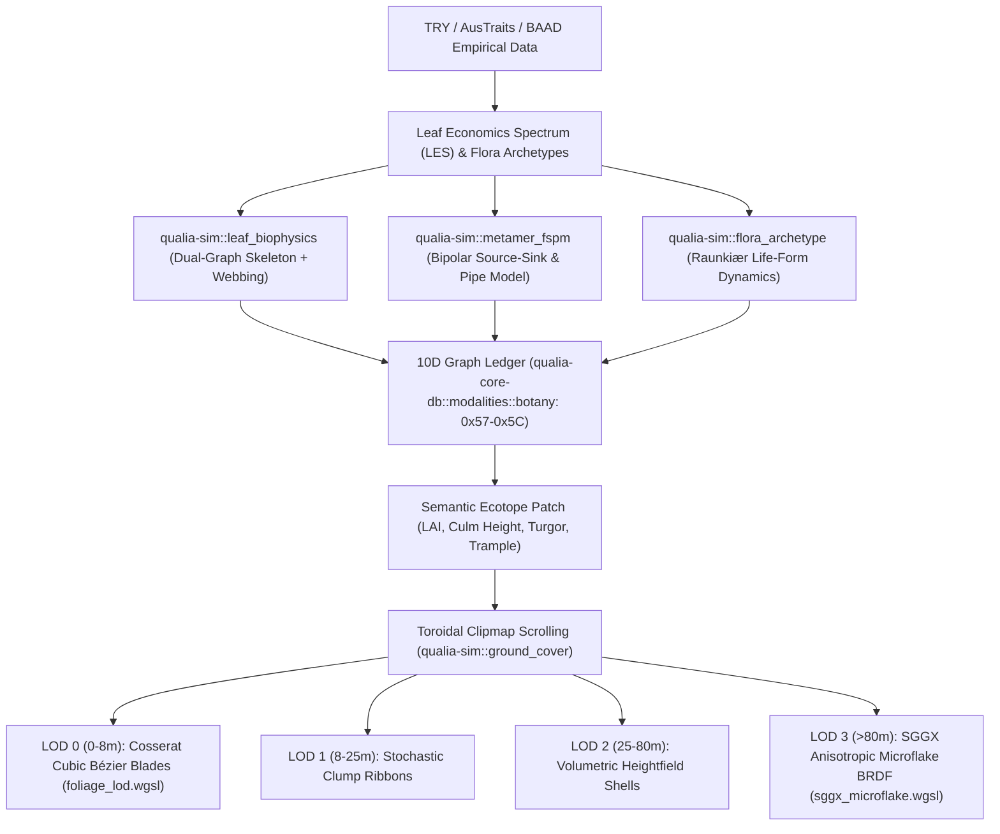

# QualiaDB Flora Biophysics, Whole-Plant FSPM & Multi-Scale Ground Cover Architecture

> **Document Class:** Technical Architecture & Biophysical Specification  
> **Status:** Fully Implemented (Zero-Heap Hot Paths, 48-Byte Super-Quin Modality, Multi-Scale WebGPU Shaders)  
> **Target Subsystems:** `crates/qualia-sim` · `crates/qualia-core-db` · `crates/webizen-render` · `crates/rolling-commons-shell`  
> **Scientific Foundations:** Murray's Law · Hagen-Poiseuille Conductance · Leaf Economics Spectrum (LES) · Shinozaki Pipe Model · Raunkiær Life Forms · SGGX Anisotropic Microflakes

---

## 1. Architectural Overview & Design Philosophy

Rather than hardcoding botanical taxonomies or storing millions of individual polygon leaves in a persistent database (which creates memory bloat and sub-pixel GPU rasterization stalls), QualiaDB decouples **Semantic Ecological State** (stored in the 10D `.q42` graph ledger) from **Screen-Space Realization** (synthesized ephemerally in WebGPU).

---

## 2. Dual-Graph Leaf Biophysics (`leaf_biophysics.rs`)

### 2.1 Vascular Skeleton & Murray's Law
Every leaf is modeled as a 1D vascular skeleton coupled to a 2D lamina webbing. As the vascular graph is traversed from leaf margin tips back to the petiole, the parent vein radius $r_p$ scales automatically via Murray's Law:
$$r_p^3 = \sum_{c \in \text{children}} r_c^3 \implies r_p = \left( r_1^3 + r_2^3 + \dots \right)^{1/3}$$

### 2.2 Hagen-Poiseuille Hydraulic Conductance
The hydraulic conductance $K_h$ of each vein segment scales with the fourth power of its radius:
$$K_h = \frac{\pi r^4}{8 \eta L}$$
where $\eta$ is dynamic water viscosity ($1.002 \times 10^{-3}\text{ Pa}\cdot\text{s}$ at $20^\circ\text{C}$) and $L$ is segment length.

### 2.3 Turgor-Coupled Cantilever Mechanics
The bulk tissue Young's modulus is actively pressurized by internal cellular turgor $P_t$:
$$E_{\text{eff}} = E_{\text{tissue}} + k_{\text{hydro}} \cdot P_t$$
When soil moisture or xylem supply drops ($P_t \to 0$), the leaf flexural rigidity $E_{\text{eff}} I$ collapses, causing the cantilever blade to droop and curl naturally under gravity and wind drag:
$$\theta_{\text{droop}} \approx \frac{M_{\text{total}} \cdot L_{\text{leaf}}}{E_{\text{eff}} \cdot I}$$

---

## 3. Whole-Plant Functional-Structural Plant Model (`metamer_fspm.rs`)

### 3.1 Shinozaki's Pipe Model Theory
Both shoot and root systems are built from atomic **Metamers** (internode rod + meristem + organ). Every active leaf demands a continuous vascular pipe down through branches and trunk to active root tips:
- **Sapwood ($P_{\text{active}}$):** Active conductive pipes that scale with current leaf canopy.
- **Heartwood ($P_{\text{retired}}$):** Retired structural pipes left behind by senesced or shaded lower boughs.

The total trunk cross-sectional radius and second moment of area develop natural basal flare and taper over successive growth cycles without manual scripting:
$$A_{\text{total}} = (P_{\text{active}} + P_{\text{retired}}) \cdot A_{\text{pipe}}, \quad I = \frac{\pi r^4}{4}$$

### 3.2 Two-Pass Source-Sink Carbon & Water Partitioning
1. **Bottom-Up Pass (Leaves & Roots $\to$ Collar):**
   - Active leaves assimilate carbon $Q$ proportional to sunlit area, light intensity, and soil moisture.
   - Accumulated mechanical torque from gravity and fruit loads propagates down the branch graph.
2. **Top-Down Pass (Collar $\to$ Sinks):**
   - Carbon pool $Q$ is partitioned to organ sinks proportional to their developmental sink strength $S_i(GDD)$.
   - Developing fruit spikes to high sink priority ($S_{\text{fruit}} \gg S_{\text{bud}}$), drawing photoassimilates and suppressing new vegetative growth during heavy fruiting years.
   - Sustained bending torque induces cambial reaction wood thickening ($P_{\text{retired}} += 1$).

---

## 4. Universal Flora Archetypes & Raunkiær Life Forms (`flora_archetype.rs`)

A single unified metamer solver handles trees, herbs, grasses, vines, and succulents by configuring three continuous properties:
1. **Lignification ($\lambda \in [0, 1]$):** Solid wood ($\lambda \approx 1$) vs. pressurized hydrostat ($\lambda \approx 0$).
2. **Cavity Ratio ($\kappa = r_i / r_o$):** Hollow cylindrical culms (grasses, bamboo) where $I = \frac{\pi}{4} r_o^4 (1 - \kappa^4)$.
3. **Gravitropic Angle ($\theta_g$):** Vertical ($\theta_g \approx 0$) vs. horizontal clonal stolons/rhizomes ($\theta_g \approx 90^\circ$).

### Raunkiær Harsh-Season Pruning State Machine
| Life Form | Bud Height ($z$) | Frost / Drought Dieback Behavior |
| :--- | :---: | :--- |
| **Phanerophyte** | $z > 0.25\text{ m}$ | High lignified trunk and boughs persist through winter. |
| **Chamaephyte** | $0 < z \le 0.25\text{ m}$ | Upper herbaceous shoots prune back; woody base survives. |
| **Hemicryptophyte** | $z = 0\text{ m}$ | All above-ground stems die back to soil collar (crowns/rosettes). |
| **Cryptophyte / Geophyte** | $z < 0\text{ m}$ | Above-ground parts vanish; subterranean bulbs/rhizomes persist. |
| **Therophyte** | $z = 0\text{ m}$ | Parent plant dies; persists strictly as dormant seeds. |

---

## 5. Viewport-Optimized Continuous Multi-Scale Ground Cover (`ground_cover.rs`)

### 5.1 Semantic Ecotope Patches & Toroidal Clipmaps
QualiaDB maintains a toroidal grid buffer centered on the camera ($32 \times 32$ cells covering local terrain). When the camera translates, wrap-around modulo indexing updates only the newly revealed 1-cell L-shaped border with **zero heap re-allocation**.

### 5.2 Megapixel Governor
Inside the GPU compute pass, the projected screen area $A_{\text{screen}}$ of each terrain patch is evaluated. Blade density is clamped so that total spawned vertices across the entire viewport never exceed $1.5\times$ viewport pixels, preventing sub-pixel quad overdraw stalls.

### 5.3 SGGX Anisotropic Microflake BRDF (`sggx_microflake.wgsl`)
At distant ranges (LOD 3, $>80\text{ m}$), individual blade geometry is replaced by an SGGX microflake BRDF on the terrain surface. The orientation tensor $S$:
$$S = \sigma_v^2 (T \otimes T) + \sigma_t^2 (I - T \otimes T)$$
- **Erect high-turgor grass:** Fiber tangent $T = [0, 1, 0]$ scatters sunlight horizontally, producing grazing velvet sheen.
- **Wilted / trampled grass:** Fiber tangent rotates horizontally along the trample vector, matching near-field Cosserat blade physics with zero triangle overdraw.

---

## 6. Verification & Implementation Status

| Component | Target File | Verification Metric |
| :--- | :--- | :--- |
| **Leaf Dual-Graph** | `crates/qualia-sim/src/leaf_biophysics.rs` | Unit tests verify Murray's Law tapering and turgor wilting droop. |
| **Whole-Plant FSPM** | `crates/qualia-sim/src/metamer_fspm.rs` | Unit tests verify Shinozaki pipe basal taper and fruit load reaction wood. |
| **Flora Archetypes** | `crates/qualia-sim/src/flora_archetype.rs` | Unit tests verify herb hydrostat buckling and Raunkiær frost dieback. |
| **Ground Cover LOD** | `crates/qualia-sim/src/ground_cover.rs` | Unit tests verify toroidal wrapping, trample injection, and SGGX fiber rotation. |
| **10D Botany Modality** | `crates/qualia-core-db/src/modalities/botany.rs` | Opcodes `0x57`–`0x5C` verified with round-trip NQuin packing and parity ECC. |
| **SGGX Microflake Shader** | `crates/qualia-core-db/src/shaders/viewport/sggx_microflake.wgsl` | Naga WGSL parse & validation certified. |
| **Foliage LOD Shader** | `crates/qualia-core-db/src/shaders/viewport/foliage_lod.wgsl` | Naga WGSL compute pass certified. |
